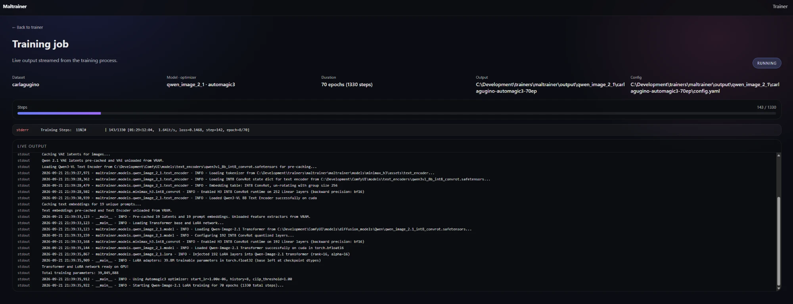

# Maltrainer

Modern AI model training toolkit for Qwen-Image 2.1, Z-Image and other modern diffusion architectures.

## Features

- **Qwen-Image 2.1 LoRA Training**: Trains directly on the ComfyUI single-file checkpoints (INT8 ConvRot
  transformer and text encoder), with no diffusers conversion. Benchmarked recommended setting: Automagic3,
  ~1500 steps, ≈ 13–16 min on an RTX 5090. Training is currently **square 512×512**; more resolutions and
  aspect-ratio bucketing are planned. See the [Qwen-Image 2.1 training guide](docs/qwen-image-2.1-lora-training.md).
- **Z-Image LoRA Training**: Train LoRA adapters for Z-Image (base) models
- **Z-Image Textual Inversion**: Train textual inversion embeddings for Z-Image
- **Krea 2 LoRA Training**: trains from ComfyUI's single files (the fp8 RAW DiT, the Qwen-Image VAE
  and Qwen3-VL-4B), with an Automagic3 template, a Prodigy template that mirrors OneTrainer's
  recipe and an AdamW 8-bit template after Fizgig's Standard preset. Optional DOP keeps the
  likeness off people the prompt doesn't name, and `scripts/boost_text_fusion.py` applies
  Fizgig's text-fusion ×3 boost to a finished LoRA. Run it with `train_krea2_lora.py`,
  `run_krea2_training.bat` or the web UI. See the [Krea 2 training guide](docs/krea2-lora-training.md).
- **FLUX.3 [klein] LoRA Training**: trains the base (undistilled) Klein from ComfyUI's single files
  (the INT8 ConvRot DiT, the Flux2 VAE and Qwen3-VL-4B), with an Automagic3 template. Run it with
  `train_flux3_klein_lora.py`, `run_flux3_klein_training.bat` or the web UI. See the
  [FLUX.3 [klein] training guide](docs/flux3-klein-lora-training.md).
- **MOSS-Image LoRA Training**: trains MOSS-Image Base (OpenMOSS, 5B) from ComfyUI's single files
  (the bf16 or INT8 ConvRot DiT, the Flux2 VAE and Qwen3.5-9B), with an Automagic3 template and a
  Prodigy template. Run it with `train_moss_image_lora.py`, `run_moss_image_training.bat` or the
  web UI. See the [MOSS-Image training guide](docs/moss-image-lora-training.md).
- **Datasets**: folder layout (subfolders are fine), `.txt` captions, several people in one set,
  sizes and buckets. See [datasets](docs/datasets.md).
- **MOSS-Image full finetuning**: `train_moss_image_finetune.py` trains the bf16 DiT's own weights
  (all 5.08B or a chosen subset) on a 32 GB GPU with fused Automagic3. It has an optional EMA in
  CPU RAM and can resume exactly from a saved state. See
  [MOSS-Image finetuning](docs/moss-image-finetuning.md).
- **Lossless LoRA merging**: `scripts/merge_loras.py` merges LoRAs into one file that applies
  exactly what stacking them does, with per-LoRA strengths given on the command line or in a YAML
  config. It also bakes a strength into a single LoRA. See [merging LoRAs](docs/merge-loras.md).
- **LoRA resizing**: `scripts/resize_lora.py` (or `resize_lora.bat`) shrinks a LoRA to a lower
  rank, such as 32 to 8, with a per-layer SVD, in seconds and with no kohya install. See
  [resizing LoRAs](docs/resize-loras.md).
- **LoRA extraction**: `scripts/extract_lora.py` (or `extract_lora.bat`) turns a full finetune
  into a LoRA with an SVD of each layer's change, at several ranks in one pass, fixed or per
  layer (LyCORIS-style `fro` / `ratio` / `threshold`). See [extracting LoRAs](docs/extract-lora.md).
- **Combined training**: `scripts/train_combined.py` trains one dataset with several optimizers,
  one after another, and merges the LoRAs into one soup at a strength each; Stabilis then resizes
  it and copies it into ComfyUI. See [combined training](docs/combined-training.md).
- **MiniMax H3 LoRA Training**: CLI trainer in `train_minimax_h3_lora.py`. It trains on stills,
  video clips with sound, and audio-only recordings, using ComfyUI's single-file checkpoints. It
  includes Fizgig's default recipe. See the [MiniMax H3 training guide](docs/minimax-h3-lora-training.md).
- **Optimizers**: AdamW 8-bit, Prodigy, and Automagic3 (self-tuning learning rate)
- **Web UI**: Pick a dataset, model and optimizer, train for a number of epochs or an exact number of steps, and
  follow live progress from a job queue
- **YAML Configuration**: Simple YAML-based configuration system
- **Modern Architecture**: Clean, modular codebase built on PyTorch and Diffusers

## Installation

### 1. Install PyTorch with CUDA support

For GPU training on Windows, you **must** install the correct CUDA version of PyTorch for your system before installing the rest of the requirements.

**For NVIDIA RTX 50-series (Blackwell) / CUDA 13.0:**
```bash
pip install torch torchvision torchaudio --index-url https://download.pytorch.org/whl/cu130
```

**For other modern GPUs (CUDA 12.4 or 12.1):**
```bash
pip install torch torchvision torchaudio --index-url https://download.pytorch.org/whl/cu124
# OR
pip install torch torchvision torchaudio --index-url https://download.pytorch.org/whl/cu121
```

### 2. Install remaining requirements

```bash
pip install -r requirements.txt
```

## Web UI (Trainer Frontend)

The trainer UI is an Angular app that talks to a FastAPI backend over HTTP + WebSocket.

### Quick launch

One command starts both the backend (port 8008) and the UI (port 3003) and opens http://localhost:3003:

```bash
run_webui.bat      # Windows: each server gets its own window
./run_webui.sh     # Linux / macOS / Git Bash: Ctrl-C stops both
```

Set your paths once: copy `webui.local.example.bat` to `webui.local.bat` (or `webui.local.example.sh` to
`webui.local.sh`) and edit `DATASETS_PATH` and `COMFYUI_MODELS_PATH`. Both files are git-ignored. A server that is
already running on its port is reused, and the first run installs the frontend dependencies (needs Node.js).
Set `WEBUI_NO_BROWSER=1` to skip opening the browser. The manual steps below do the same thing in two terminals.

### Backend setup

1. Set the datasets root (optional; defaults to `./datasets`) and, for Qwen-Image 2.1, your ComfyUI models folder:
   ```bash
   # Windows (PowerShell)
   $env:DATASETS_PATH = "C:\Development\projects\maltrainer\datasets"
   $env:COMFYUI_MODELS_PATH = "C:\ComfyUI\models"
   # Linux/macOS
   export DATASETS_PATH="/path/to/datasets"
   export COMFYUI_MODELS_PATH="/path/to/ComfyUI/models"
   ```
   The backend finds the three Qwen-Image 2.1 files anywhere under `diffusion_models/`, `text_encoders/` and `vae/`.

2. Run the API server:
   ```bash
   python -m uvicorn backend.app:app --host 0.0.0.0 --port 8008
   ```

### Frontend setup

1. Install UI dependencies:
   ```bash
   cd frontend
   npm install
   ```

2. Run the UI:
   ```bash
   npm start
   ```

3. Open http://localhost:3003

The UI lists datasets from `DATASETS_PATH`. For each run you pick:

- **Model**: Qwen-Image 2.1 (default) or Z-Image. Missing Qwen model files are reported up front.
- **Optimizer** and **learning rate**: Automagic3 (recommended for Qwen), AdamW 8-bit, or Prodigy. Picking an
  optimizer fills in its default learning rate.
- **Train for**: **Max steps** (stops exactly at N) or **Epochs** (N full passes). For Qwen, leave Max steps empty
  and the UI picks a step count from your dataset size (~70 epochs, kept within 1000–2500 steps). Z-Image only runs
  whole epochs, so a step budget there is rounded up to the next epoch.
- **Save every**, and the **trigger word** (defaults to the dataset folder name).

A plan preview shows total steps, epochs, an estimated time, and the output folder before you start, plus notes
and warnings: how the automatic step count was chosen, a run that is too short or too long, and non-square images
(Qwen training is currently square 512×512, so they get squashed; crop them first). Jobs start
right away when the trainer is idle and queue otherwise. Dry runs walk through the planned steps without loading
models. Qwen runs each get their own folder: `output/qwen_image_2_1/<dataset>-<optimizer>-<duration>/`.

Click **Open** on a job for its live page, with a progress bar, speed and time remaining, and the full log:

[](docs/images/qwen21-web-ui/training-job.webp)

See [Watching a run](docs/qwen-image-2.1-lora-training.md#watching-a-run) for what each part shows.

## Quick Start

### Qwen-Image 2.1 LoRA Training

1. Put the three Comfy-Org Qwen-Image 2.1 files in your ComfyUI models folder (see the
   [guide](docs/qwen-image-2.1-lora-training.md#requirements)).
2. Prepare a dataset folder: **square images** (training is square 512×512 for now, with no cropping or bucketing
   yet, so crop first) and optional `.txt` captions.
3. Copy the template, replace `[comfyui_models]` and `[person_to_train]`, and train:
   ```bash
   cp templates/qwen_image_2_1_template.yaml config/my_qwen_lora.yaml
   python train_qwen_image_2_1_lora.py --config config/my_qwen_lora.yaml
   ```
   Or use the web UI, which fills the template in for you.

### LoRA Training

1. Prepare your dataset (images with optional `.txt` caption files)
2. Copy and edit the example config:
   ```bash
   cp templates/examples/train_zimage_lora_example.yaml config/my_lora.yaml
   ```
3. Run training:
   ```bash
   python train_zimage_lora.py --config config/my_lora.yaml
   ```

### Textual Inversion Training

1. Prepare your dataset (images with optional `.txt` caption files)
2. Copy and edit the example config:
   ```bash
   cp config/train_zimage_embedding_example.yaml config/my_embedding.yaml
   ```
3. Run training:
   ```bash
   python train_zimage_embedding.py --config config/my_embedding.yaml
   ```

## Training

### Preparing Your Dataset

Before training, organize your images in a directory structure like this:

```
my_dataset/
├── image1.jpg
├── image1.txt    # Optional caption file
├── image2.png
├── image2.txt
└── ...
```

- **Images**: Supported formats include `.jpg`, `.jpeg`, `.png`, `.webp`
- **Captions**: Text files with the same name as the image (optional)
- **Resolution**: Images will be resized according to your config (default 512x512)

### Configuring Training

1. **Choose the right config template**:
   - For LoRA training: `templates/examples/train_zimage_lora_example.yaml`
   - For Textual Inversion: `config/train_zimage_embedding_example.yaml`

2. **Edit the configuration**:
   - Set `dataset.path` to your dataset directory
   - Adjust `train.batch_size` and `gradient_accumulation_steps` based on your GPU VRAM
   - Modify learning rates and epochs as needed
   - Configure output paths and logging

3. **Key parameters to customize**:
   - `model.name_or_path`: Path to Z-Image model
   - `dataset.resolution`: Training resolution
   - `train.learning_rate`: Learning rate (higher for embeddings)
   - `train.num_epochs`: Number of training epochs
   - `output.path`: Where to save checkpoints

### Z-Image Turbo Templates

Two Turbo templates are included so you can compare the de-distilled model vs the training adapter approach:

- De-distilled (OneTrainer-style): [templates/zimage_turbo_template-onetrainer.yaml](templates/zimage_turbo_template-onetrainer.yaml)
- Training adapter (AI Toolkit-style): [templates/zimage_turbo_template-adapter.yaml](templates/zimage_turbo_template-adapter.yaml)

Notes:
- `model.extras_name_or_path` points the text encoder + VAE to the Turbo base while the transformer loads from the de-distilled model.
- `model.assistant_lora_path` merges the Turbo training adapter into the transformer before training.
- Both templates default to LoRA `rank: 16` and `alpha: 1` to match the OneTrainer config you provided; adjust if you prefer a different rank/alpha.
- Maltrainer now supports logit-normal timestep sampling and LR warmup via `train.timestep_distribution` and `train.learning_rate_warmup_steps`.
- Quantized transformer weights (INT_W8A8) and async offloading/compile are still not implemented, so results may differ from OneTrainer in those areas.

### Running Training

Execute the training script with your config:

```bash
# For LoRA training
python train_zimage_lora.py --config config/my_lora.yaml

# For Textual Inversion
python train_zimage_embedding.py --config config/my_embedding.yaml
```

For testing, you can simulate training without downloading the model:

```bash
# Dry run (default 0.025s per step)
python train_zimage_lora.py --config config/my_lora.yaml --dry-run

# Dry run with custom step time
python train_zimage_embedding.py --config config/my_embedding.yaml --dry-run --dry-run-step-time 0.1
```

### Monitoring Training

- Training progress is logged to the console
- Checkpoints are saved periodically (every 500 steps by default)
- Monitor GPU usage and adjust batch size if needed
- Training can be interrupted and resumed (checkpoints include optimizer state)

### Output Files

Training produces:
- `zimage_lora_step_XXXX.safetensors` or `zimage_embedding_step_XXXX.safetensors`: Model checkpoints
- `config.yaml`: Saved configuration for reference
- Logs in the output directory

## Configuration

All training parameters are configured via YAML files. See `config/` directory for examples.

### Key Configuration Sections

- **model**: Model path and architecture settings
- **lora/embedding**: Adapter-specific configuration
- **dataset**: Dataset path and preprocessing
- **train**: Training hyperparameters
- **output**: Output directory configuration
- **logging**: Logging settings

## Dataset Structure

```
dataset/
├── image1.jpg
├── image1.txt
├── image2.jpg
├── image2.txt
└── ...
```

- Images: `.jpg`, `.jpeg`, `.png`, `.webp`
- Captions: Optional `.txt` files with same name as image
- For textual inversion, captions can be empty (trigger token will be used)

## Output Structure

```
output/
├── config.yaml           # Saved configuration
├── zimage_lora_step_500.safetensors
├── zimage_lora_step_1000.safetensors
└── ...
```

## Requirements

- Python 3.10+ (3.12 recommended for RTX 50-series)
- PyTorch 2.10+ (for CUDA 13.0 support)
- CUDA 11.8 - 13.0 (for GPU training)
- 24GB+ VRAM recommended for Z-Image
- ≈ 11 GB VRAM for Qwen-Image 2.1 at 512px (INT8 base model)
- `transformers` 4.57+ for the Qwen3-VL text encoder (Qwen-Image 2.1, MiniMax H3)

## Documentation

See `docs/` directory for detailed documentation:
- [Qwen-Image 2.1 LoRA Training](docs/qwen-image-2.1-lora-training.md)
- [Qwen-Image 2.1 Optimizer Benchmark: AdamW vs Prodigy vs Automagic3](docs/qwen-image-2.1-optimizer-benchmark.md)
- [Textual Inversion and Z-Image Support](docs/textual-inversion-z-image.md)
- [Training Options and OneTrainer Parity](docs/training-options-and-parity.md)
- [OneTrainer Architecture and Multi-Model Plan](docs/onetrainer-architecture-and-multi-model-plan.md)

## License

MIT License

## Credits

Built with inspiration from:
- ai-toolkit
- musubi-tuner
- kohya_ss
- stable-diffusion-webui
- ComfyUI
