# Architecture

How maltrainer is built: the system around it, its containers, the components inside each, the main runtime
flows, and the rules that keep the code in that shape. For where each file lives, read
[code-layout.md](code-layout.md); for how to use the trainers, the guides linked from the [README](../README.md).

Every box below is a real package, module or file; every arrow is an import, a call, a file or a protocol that
exists in the code. The diagrams are [Mermaid](https://mermaid.js.org/) (C4 syntax and sequence diagrams) and
render on GitHub.

## 1. Purpose and scope

maltrainer trains LoRAs, full finetunes and (deprecated, a proof of concept) textual-inversion embeddings of modern image (and, for MiniMax H3,
video and audio) diffusion models on one local GPU. It works directly on the single-file checkpoints that ComfyUI
uses (bf16, fp8, INT8 ConvRot, NVFP4), writes its results as safetensors files that ComfyUI loads, and offers the
same trainers through a command line and a small web UI that queues jobs and follows their progress. It
is not a service: everything runs on the user's machine, one trainer process at a time, and there is no database,
no authentication and no network exposure beyond the UI's own local ports.

The model families are FLUX.3 [klein], Krea 2, MOSS-Image, MiniMax H3, Qwen-Image 2.1 and Z-Image (LoRA and textual
inversion), plus full finetuning of MOSS-Image and Krea 2.

Who uses it:

- **A LoRA or finetune author** (the main user) who picks a dataset, a model and an optimizer in the web UI, or
  edits a YAML config and runs `train_<model>_lora.py`, and then uses the result in ComfyUI.
- **The same person as a tool user**, running the scripts in `scripts/` to merge, resize, extract or inspect LoRAs,
  or to convert a bf16 checkpoint to INT8 ConvRot.
- **A maintainer**, who changes the code under the quality gate (section 7).

## 2. System context (C4 level 1)

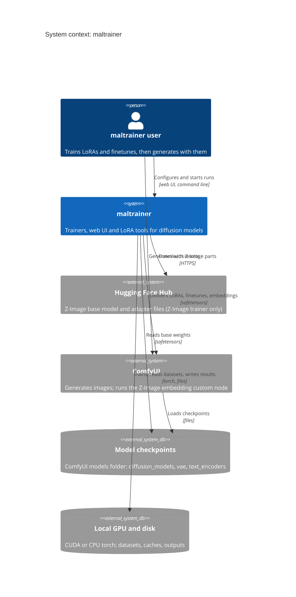

What the code actually touches:

- **ComfyUI** is a file-level partner, never a runtime one: maltrainer reads ComfyUI's checkpoint files (the backend
  finds them under `COMFYUI_MODELS_PATH` in `diffusion_models/`, `vae/` and `text_encoders/`), and the user copies
  the safetensors it writes back into ComfyUI. The one piece of code that runs inside ComfyUI is the Z-Image
  textual-inversion custom node in `comfyui-zimage-embedding/`.
- **Hugging Face** is used only by the Z-Image path: `maltrainer/trainers/zimage/model.py` calls `from_pretrained`
  for the diffusers pipeline pieces and `hf_hub_download` for adapters; `scripts/infer_zimage.py`,
  `scripts/check_*_lora.py` and the ComfyUI node load `Tongyi-MAI/Z-Image` the same way. The other families read only
  local files; their tokenizers ship in `maltrainer/models/*/assets/`.
- **pip / PyPI** is touched at install time (`uv sync`, `pip install -r requirements.lock`) and by the quality
  gate's audit step, never by the running trainers.

## 3. Containers (C4 level 2)

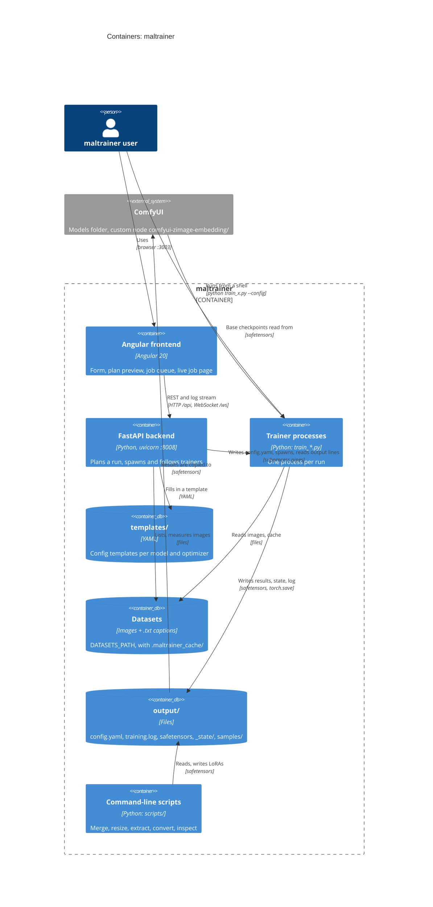

Notes that the picture cannot carry:

- **Frontend to backend.** The UI is served by `ng serve --port 3003` with `proxy.conf.json` forwarding `/api` and
  `/ws` to `http://localhost:8008`. The backend's CORS list allows only the UI's own origin (`localhost:3003`,
  `127.0.0.1:3003`). The job page is the only websocket client; everything else is plain JSON over HTTP.
- **Backend to trainer.** There is no import between them, apart from `backend/files.py` using
  `maltrainer.data.walk`. The backend knows the trainers as data: `backend/registry.py` lists, per model, the script
  name, the template, the required checkpoint files, the optimizers and the benchmark-derived defaults. It starts
  `sys.executable -u <script> --config <run>/config.yaml`, with `--dry-run` for a simulated run, and learns about
  progress by matching `12/1500`-style counters in the process's stdout and stderr (`backend/streams.py`).
- **What the UI can start.** The registry offers Z-Image, Qwen-Image 2.1, Krea 2, FLUX.3 [klein] and MOSS-Image LoRA
  runs. The MiniMax H3 trainer, the textual inversion trainer and the two finetunes are command-line only.
- **State.** The backend keeps its jobs in memory (`backend/training.py`: `jobs`, `queued_job_ids`, a 2000-line log
  buffer per job). A backend restart forgets the job list; the trainer processes it started are not stopped by the
  backend (it has no cancel route), and their files remain in `output/`.
- **The quality tooling** is a separate container in spirit: `maltrainer_quality/` and its CI workflow only read the
  repository (section 7).
- **Frontend tests** (Jest, `frontend/src/app/**/*.spec.ts`) and the Python tests (`tests/`) are outside the diagram.

## 4. Components (C4 level 3)

### 4.1 The trainer container

Each `train_*.py` is a thin entry point; the packages below it are the shared machinery. Edges point from the
importer to the imported package; the diagram shows the main spine, and the full import table is in 6.1
(for example, the FLUX.3 and Krea 2 LoRA entry points also import `models`, `data` and `utils` directly).

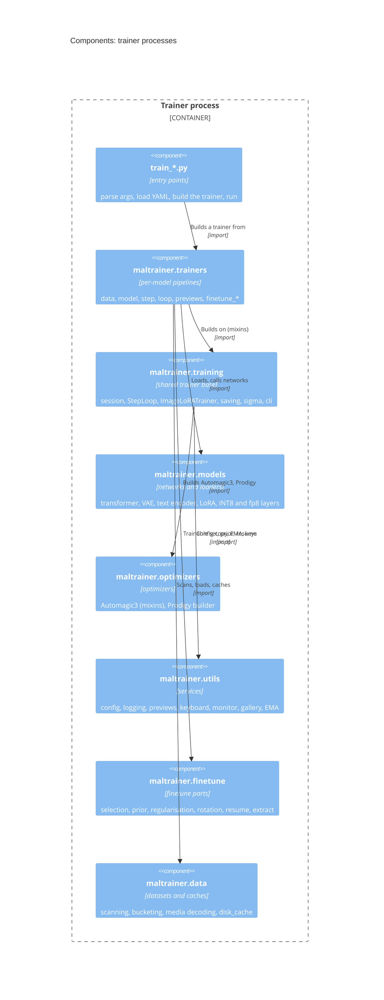

Which trainer is built on which base:

| Entry point | Pipeline | Base |
|---|---|---|
| `train_flux3_klein_lora.py`, `train_krea2_lora.py` | the class lives in the entry point itself | `ImageLoRATrainer` |
| `train_fibo2_lora.py` | the class lives in the entry point; `trainers/fibo2/timesteps` | `ImageLoRATrainer` |
| `train_moss_image_lora.py` | `trainers/moss_image` (`cache`, `previews`, `timesteps`), `training/advice` | `ImageLoRATrainer` |
| `train_moss_image_finetune.py` | `trainers/moss_image/finetune_*` | the MOSS-Image LoRA trainer (4.4) |
| `train_krea2_finetune.py` | `trainers/krea2/finetune_*`, `trainers/krea2/previews`, `trainers/finetune` | the Krea 2 LoRA trainer, imported from `train_krea2_lora` |
| `train_minimax_h3_lora.py` | `trainers/minimax_h3` | its own class; reuses `training.session`, `saving`, `steps` |
| `train_qwen_image_2_1_lora.py` | `trainers/qwen_image_2_1` | its own class; reuses `training.progress`, `saving`, `session` |
| `train_zimage_lora.py`, `train_zimage_embedding.py` | `trainers/zimage` (`Pipeline`) | `zimage.pipeline.Pipeline` |

`ImageLoRATrainer` (`training/image_lora.py`) plus `StepLoop` (`training/loop.py`) are shared by FLUX.3, Krea 2 and
MOSS-Image. H3, Qwen 2.1 and Z-Image have loops that differ too much (packed audio and video, a DataLoader loop,
diffusers pipelines) and reuse only the small helpers.

### 4.2 The backend container

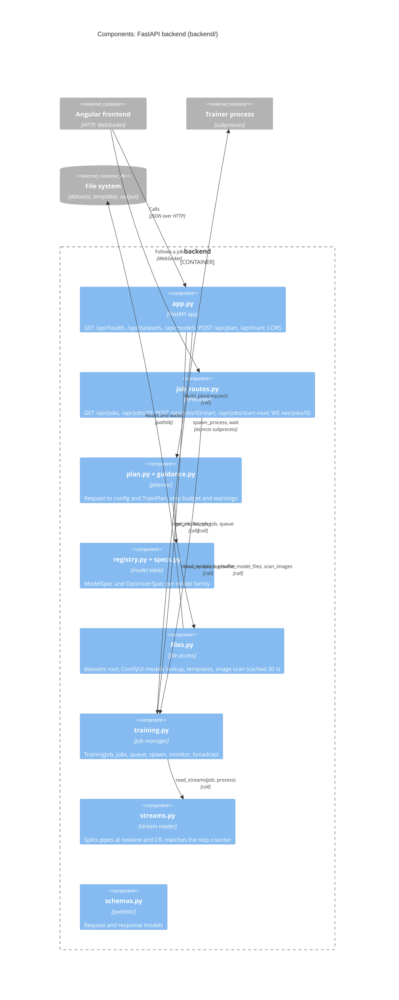

All of `app.py`, `job_routes.py`, `plan.py` and `training.py` exchange `schemas.py` models, and `app.py` also uses
`files` and `registry` directly (omitted from the picture for readability). The module import graph is acyclic:
`specs` is the leaf; `registry`, `files`, `guidance` and `streams` sit on it; `plan` and `training` above those; the
two route modules on top.

### 4.3 A model family's package (`models/<model>/`, shown for MOSS-Image)

All families use the same split; the file names differ a little (see [code-layout.md](code-layout.md)).

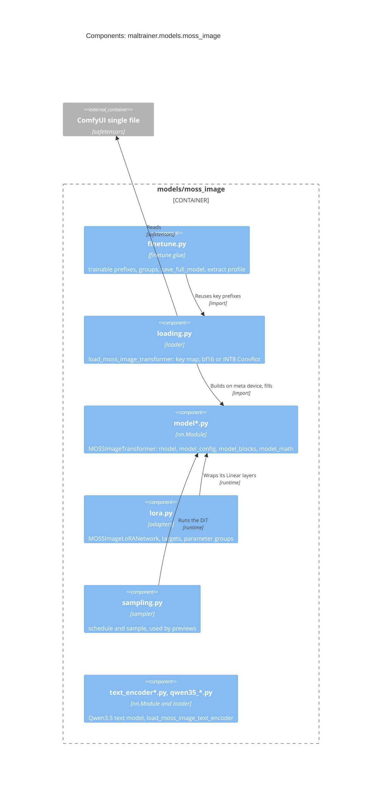

The other families follow the same shape: `krea2` (`model`, `layers`, `rope`, `loading`, `text_encoder`, `vae`,
`timesteps`, `lora`, `finetune`), `flux3` (`model`, `config`, `layers`, `rope`, `loading`, `text_encoder`, `vae`,
`vae_net`, `lora`), `fibo2` (`model`, `config`, `blocks`, `layers`, `rope`, `loading`, `prompt`, `text_encoder`, `lora`;
its VAE and LoRA layer are FLUX.3's and its text encoder loads like FLUX.3's), `qwen_image_2_1` (`model*`, `vae*`, `text_encoder`, `checkpoint`, `lora*`) and `minimax_h3`
(`model*`, `video_vae*`, `audio_vae*`, `text_encoder*`, `lora*`, and the shared INT8 and `comfy_quant*` layers). The
VAE of MOSS-Image is FLUX.3's Flux2 VAE (`models/flux3/vae.py`), and the INT8 ConvRot kernels live in
`models/minimax_h3/int8_*.py` and are used by four families, so the model packages know each other (section 6.1).

### 4.4 The MOSS-Image finetune: mixins on top of the LoRA trainer

The finetune is the most intricate part. It reuses the LoRA trainer's data caching, sigma sampling, loss and previews,
and replaces the model side. The trainer class is assembled from mixins, listed ahead of the LoRA trainer in its
bases, so the mixins' methods win in the method resolution order. The order below is the real `__mro__`.

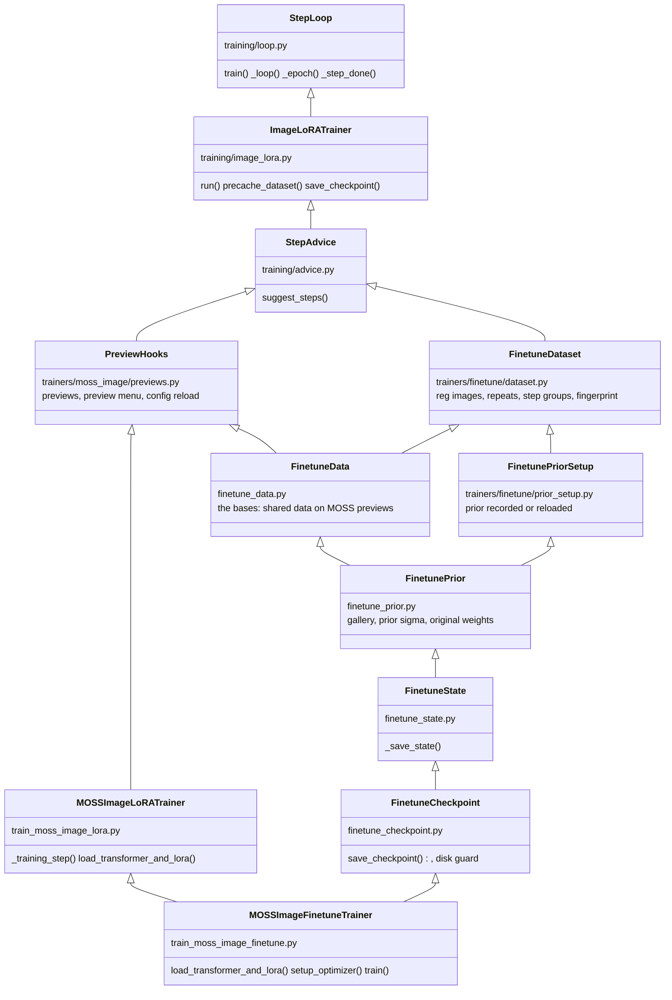

The effective order (`MOSSImageFinetuneTrainer.__mro__`) is: finetune trainer, `FinetuneCheckpoint`, `FinetuneState`,
`FinetunePrior`, `FinetunePriorSetup`, `FinetuneData`, `FinetuneDataset`, `MOSSImageLoRATrainer`, `PreviewHooks`,
`StepAdvice`, `ImageLoRATrainer`, `StepLoop`. `FinetuneDataset` and `FinetunePriorSetup` (in `trainers/finetune/`)
are shared with the Krea 2 finetune, whose order is: `Krea2FinetuneTrainer`, `FinetunePriorSetup`, `FinetuneDataset`,
`StepAdvice`, `Krea2Previews`, `PreviewHooks`, `Krea2LoRATrainer`, `ImageLoRATrainer`, `StepLoop`.
`finetune_host.py` holds only the state folder's file names. A stub that must not shadow a later class is declared
under `if TYPE_CHECKING:` (`FinetunePrior._name`, `_sample_sigma`).

The pieces that are plain functions over the trainer (the "host") rather than mixins:

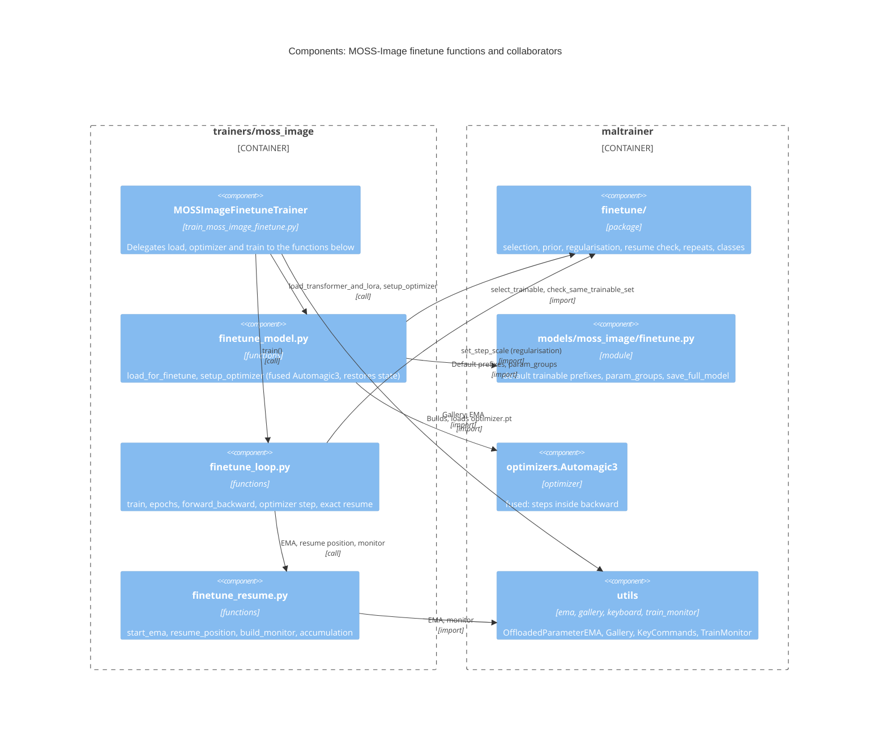

### 4.5 The frontend (optional view)

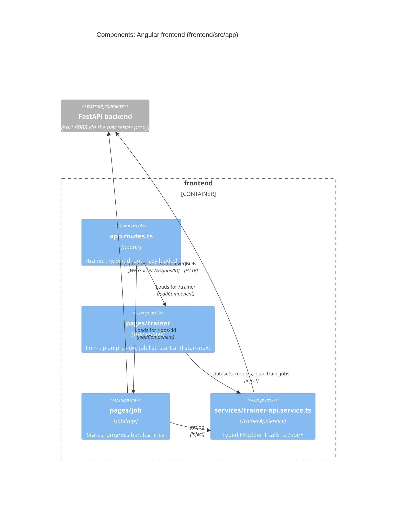

## 5. Runtime views

### 5.1 Starting a training from the UI

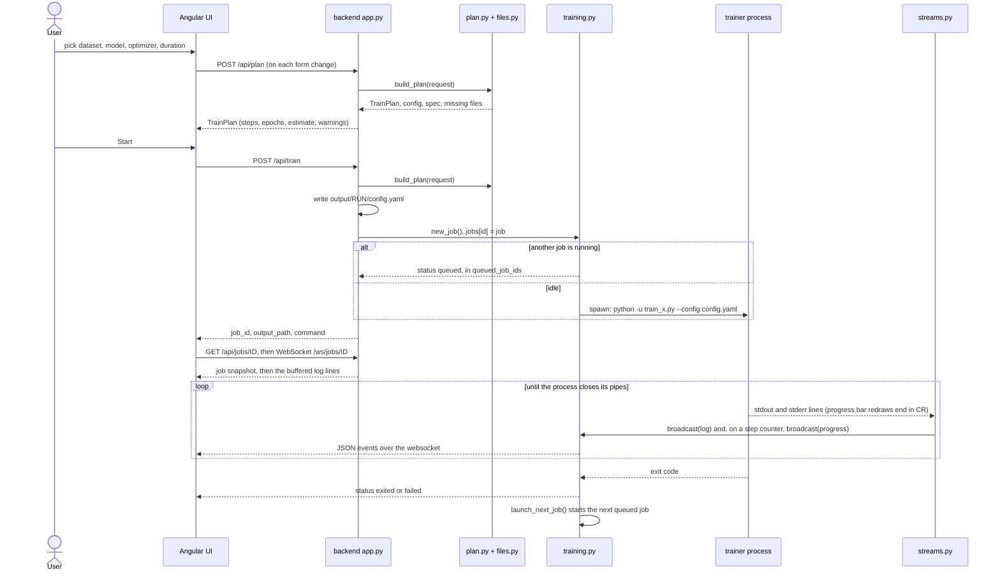

The plan call returns a 400 for an unknown model and a 404 for an unknown dataset; `/api/train` refuses (400) a
real run whose checkpoint files are missing, but allows a dry run.

### 5.2 One training step (image LoRA trainers, as MOSS-Image does it)

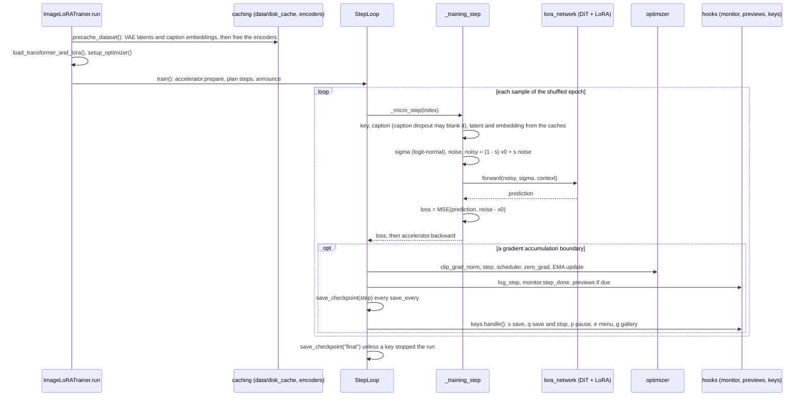

The LoRA and finetune trainers differ in step plumbing, not in the shape: the finetune's `finetune_loop.py` runs the
same sample, sigma, noise, forward and loss, adds the prior term when due, scales regularisation images, and lets the
fused Automagic3 update each parameter inside `backward()` (so `optimizer.step()` there only applies the learning-rate
votes). Other model families (Z-Image, Qwen 2.1, H3) have their own `step` modules with the model's target and loss.

### 5.3 Exact resume of the MOSS-Image finetune

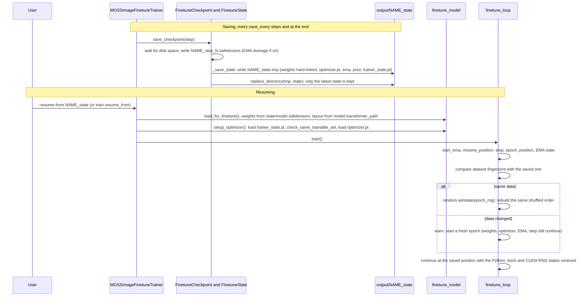

The check that makes it exact: the saved epoch RNG state regenerates the epoch's shuffled order, the saved position
picks the next sample, and the three RNG states give the same noise and sigma draws as the uninterrupted run. The
exact-resume tests are in `tests/trainers/moss_image/` and `tests/trainers/krea2/`, and must keep passing.

## 6. Architecture description

### 6.1 Layers and dependency rules

Top to bottom, a package may import from the ones below it:

```
train_*.py               entry points (also: scripts/, backend/ for its own needs)
maltrainer/trainers/     one model's pipeline
maltrainer/training/     shared trainer machinery
maltrainer/control/      the control API (REST, served from the trainer process)
maltrainer/models/  maltrainer/finetune/  maltrainer/optimizers/  maltrainer/data/  maltrainer/utils/
```

The imports as they are today (every `import` and `from ... import`, found by walking the syntax trees of the
non-test code; a function-level import counts):

| Package | Imports from `maltrainer.` |
|---|---|
| `data` | nothing |
| `optimizers` | nothing |
| `control` | `utils` |
| `training` | `control`, `data`, `optimizers`, `utils` |
| `utils` | `data`, `finetune` |
| `finetune` | `data`, `models`, `utils` |
| `models` | `finetune`, `training` (one import each, see below) |
| `trainers` | `control`, `data`, `finetune`, `models`, `optimizers`, `training`, `utils` |
| `train_*.py` | all of the above, and `trainers` |
| `scripts/` | `data`, `finetune`, `models`, `utils` |
| `backend/` | `data.walk` only |

What holds, and what does not:

- **Held strictly.** `data` and `optimizers` are leaves. `trainers` is imported only by entry points, never by the
  library or the backend. Nothing in `maltrainer/`, `scripts/` or `backend/` imports a `train_*.py`; the only
  entry-point imports are `train_moss_image_finetune.py` from `train_moss_image_lora.py` and
  `train_krea2_finetune.py` from `train_krea2_lora.py` (a finetune extends its LoRA trainer). The backend never
  imports a trainer.
- **Not strictly layered.** At package level there are three cycles, each through a few modules, none of them
  between two modules that import each other:
  - `models` and `finetune`: `models/krea2/finetune.py` imports `finetune.rotation`, `models/moss_image/finetune.py`
    imports `finetune.extract`, and `finetune/rotation.py` imports `models.comfy_fp8`.
  - `utils` and `finetune`: `utils/step_planner.py` imports `finetune.repeats`, `utils/gallery.py` imports
    `finetune.classes`, and `finetune/notes.py` imports `utils.step_planner`.
  - `models` reaches up into `training` once: `models/krea2/timesteps.py` imports `training.sigma`.

  Treat `models`, `finetune` and `utils` as one band of peers that must stay acyclic at module level, not at
  package level. `tests/maltrainer/test_layering.py` enforces this: it pins the table above (a new dependency
  between packages fails the test until the table in the test and here are changed together), forbids the library
  importing `trainers` or an entry point, and fails on any import cycle between modules.
- **Models know each other.** The shared INT8 ConvRot layers live in `models/minimax_h3/int8_*.py` and
  `comfy_quant*.py`, and `flux3`, `fibo2` (through the FLUX.3 text-encoder loader), `qwen_image_2_1` and `moss_image` import them (and each other's VAE, LoRA layer or
  text encoder pieces). The rule is: reuse, do not copy; the cost is that `minimax_h3` is more of a platform
  package than its name says.
- **Where logic lives.** Reusable code goes into `maltrainer/` and not into `train_*.py` (200 lines at most). A
  module that was split keeps its old name and re-exports its public names, so old import paths and test patches
  keep working; tests patch a name in the module where the code looks it up.
- **Mixins and the host.** A finetune or trainer part that needs the trainer's attributes takes the trainer as a
  `host: Any` (functions in `finetune_*.py`) or declares the attributes it reads on the mixin class. Methods that
  tests patch stay on the trainer.

### 6.2 Architectural forces from the quality gate

`python -m maltrainer_quality` (see "Quality gate" in the [README](../README.md)) is a design constraint, not a
chore. Three limits shape the code:

- **200 lines per Python or shell file**, with no exceptions list. This is why a model is a package of `model`,
  `model_config`, `model_blocks`, `model_math`, a trainer is a set of `finetune_*` mixins, and Automagic3 is five
  modules.
- **Cyclomatic complexity 10 per function.** Long procedures become tuples of small steps (`finetune_loop.py`,
  `automagic3_update.py`), and options travel as small dataclasses or tuples.
- **mypy strict over the whole tree** (`maltrainer`, `backend`, `scripts`, `train_*.py`, the quality package). This
  is why shared state is declared as class attributes on the mixins, and why heavy optional libraries are typed as
  `Any` where they ship no stubs.

Further gates: ruff lint and format, dead-code check (vulture), tests with a 99 % coverage floor, `uv.lock` and
`requirements.lock` consistency, and a pip audit. CI (`.github/workflows/quality.yml`) runs the same command as a
developer does.

Mutation testing is not a gate: `python -m maltrainer_quality.mutation` (its own runner, `maltrainer_quality/mutation*.py`)
mutates the pure-math modules and checks that the unit tests notice, against a per-module score floor. It runs before a
merge that touches such a module and as an optional CI job; the policy is in [mutation-testing.md](mutation-testing.md).

### 6.3 Data flow and file formats

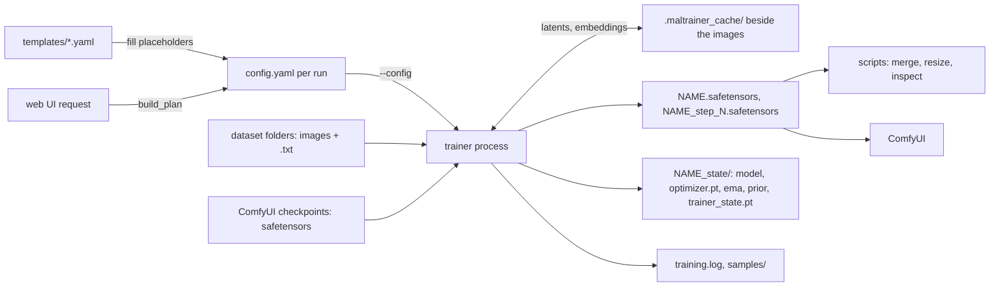

- **Config** is YAML with the sections `model`, `dataset`, `train`, `lora` / `finetune` / `prior`, `output`, `sample`,
  `logging`. `utils/config.py` loads it; `training/cli.start_run` configures logging and saves a copy as
  `<output.path>/config.yaml`. Some settings are re-read while a MOSS-Image run is going (`sample:` section, via
  `PreviewHooks`).
- **Checkpoints in** are single ComfyUI files (bf16, fp8 scaled, INT8 ConvRot, NVFP4). Loaders map ComfyUI's keys onto
  the model modules, build the network on the meta device and fill it, and switch the quantized Linears to their
  integer kernels (`models/*/loading.py`, `checkpoint.py`, `comfy_fp8*.py`, `int8_*.py`).
- **LoRAs out** are safetensors with `ss_*` metadata and, by default, the whole training config embedded
  (`utils/lora_metadata.py`, `training/saving.write_lora`); `scripts/inspect_lora_metadata.py` reads it back.
  Finetunes out are full ComfyUI-layout single files in the source file's key layout
  (`models/moss_image/finetune.save_full_model`), about 10 GB each.
- **Resume state** is a folder `<name>_state/` with `model.safetensors`, `optimizer.pt`, `ema.safetensors`,
  `prior.safetensors` and `trainer_state.pt` (step, epoch, position, RNG states, group and parameter names, dataset
  fingerprint). It is written aside as `.tmp` and swapped in whole, with the weights hard-linked to the checkpoint
  when they are identical.
- **Disk cache** (`data/disk_cache.py`, used by `trainers/moss_image/cache.py`): each image folder gets
  `.maltrainer_cache/<kind>/<key>.safetensors` for latents and caption embeddings, keyed by content hash and model
  identity. Other trainers cache in memory per run.
- **Run folders.** The UI gives each run (Qwen 2.1, Krea 2, FLUX.3, MOSS-Image) its own
  `output/<model>/<dataset>-<optimizer>-<duration>/`; Z-Image writes straight to `output/<dataset>`.

### 6.4 Key design decisions

- **ComfyUI single files, no diffusers conversion.** Weights are read from the files users already have, in the
  precision they are stored in: INT8 ConvRot (a per-row int8 weight with a Hadamard-rotated input, run on int8
  kernels), fp8 scaled (`Fp8ScaledLinear`) and NVFP4 layers. The networks are re-implemented in this repository
  (`models/*/model*.py`) so a checkpoint's keys map one to one; only the Z-Image trainer still builds on diffusers.
- **A shared base where loops agree, separate loops where they do not.** `ImageLoRATrainer` and `StepLoop` carry what
  FLUX.3, Krea 2 and MOSS-Image share: caching, the epoch and accumulation loop, saving, keys and hooks. A model adds
  `precache_dataset`, `load_transformer_and_lora` and `_training_step`. H3, Qwen 2.1 and Z-Image keep their own loops
  rather than bend the base. The OneTrainer-style `ModelAdapter` / `GenericTrainer` split proposed in
  [the multi-model plan](onetrainer-architecture-and-multi-model-plan.md) was not built that way.
- **Automagic3** (`optimizers/automagic3*.py`, vendored and split into mixins) adapts a learning rate per module family
  from a packed sign history, rounds updates stochastically into bf16 weights, and clips each tensor's update by RMS.
  Trainers choose the sign window per model.
- **Fused backward hooks.** With `fused: true`, Automagic3 registers `register_post_accumulate_grad_hook` on every
  parameter so each one updates as soon as its gradient exists; no full set of gradients is held. The cost is no
  gradient accumulation and no global clipping, which the finetune trainers check at start.
- **Rotating fp8 windows for the Krea 2 finetune** (`finetune/rotation.py`, `trainers/krea2/finetune_*`): the frozen
  model sits on the GPU in fp8, one window of Linears at a time is swapped to a trainable bf16 copy from a CPU master,
  trained for `finetune.rotate_every` steps, written back and re-quantized. Optimizer state follows each window to CPU
  RAM and back. `finetune/rotation_base.py` puts the original weights in for a while (a resumed run recording the prior
  of images added since) and re-quantizes from the master afterwards, bit for bit.
- **Exact resume** for both finetunes: the state folder, the epoch order from a saved RNG state, restored RNG streams
  and a dataset fingerprint (5.3).
- **Backend as a thin planner.** All model knowledge in the UI path is data in `backend/registry.py`; the trainers
  are black boxes behind a command line and a stdout contract (a `N/M` counter). The price is that the UI can start
  only the trainers listed there.
- **Previews, monitor and gallery are MOSS-Image features** (`utils/previews*.py`, `preview_menu.py`,
  `train_monitor.py`, `gallery.py`, `keyboard.py`, wired through `trainers/moss_image/previews.py`); the Krea 2
  finetune uses the keyboard and the monitor only.

### 6.5 Cross-cutting concerns

- **Configuration**: YAML in, one dict through the whole run, defaults read at the point of use with `.get`; the
  backend only edits the template (paths, trigger, steps, save interval).
- **Logging**: `utils/logging_utils.setup_logging`; `training/session.open_training_log` adds
  `<output>/training.log`, and a separate `progress` logger writes the per-step lines to that file only. The console's
  stdout is what the backend streams.
- **Previews and the keyboard menu**: `Previews` renders fixed prompts into `<output>/samples/` at the step
  boundary, with the weights in training (EMA rows optional); `KeyCommands` reads single keys (`s` save,
  `q` save and stop, `p` pause, `e` preview menu, `g` gallery, `h` help) at the step boundaries; the listener is off when stdin is not a
  console, so a trainer started by the web UI has no keys; the time spent in menus is excluded from the speed
  figures.
- **Reproducibility**: seeds via `accelerate.utils.set_seed`; step and epoch plans in `training/steps.py`; the
  finetune's resume state restores every RNG stream.
- **Testing**: `tests/` mirrors the code. Tests run the real trainer code on tiny CPU models and fake only the
  loaders (`tests/trainers/<model>/fakes.py`, `world.py`, `runs.py`), including real saves and resumes in temporary
  folders. Backend tests use Starlette's `TestClient` and fake process spawns; the frontend has Jest specs.
- **Refactors without behaviour change**: a split is proven by running the old and the new code on seeded tiny models
  and comparing tensors, state dicts, saved files and logs byte for byte (see [code-layout.md](code-layout.md)).
- **Quality gates**: the diagram below.

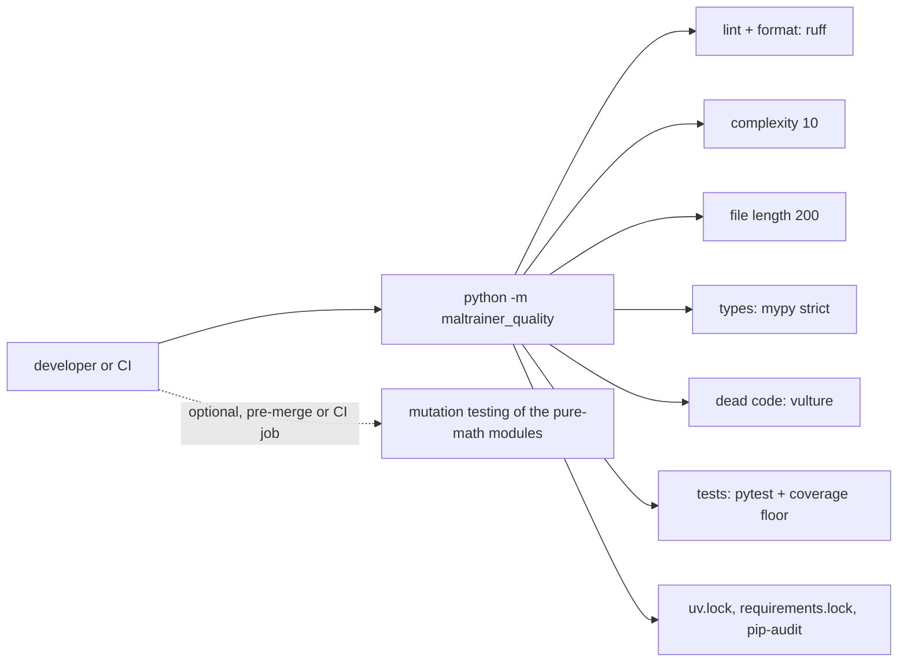

### 6.6 Known limits and risks

- **One GPU, one job.** The backend runs one trainer at a time and queues the rest; the finetunes refuse more than one
  process. There is no multi-GPU path for them.
- **In-memory job state.** A backend restart loses the job list and the websocket buffers (2000 lines per job); the
  backend has no cancel or stop route, so a running job is stopped from its console or by the OS.
- **Progress by pattern.** The UI's progress comes from a regular expression over the trainer's output; a trainer that
  prints a different counter first, or changes its log format, breaks the bar without breaking the run.
- **Square or bucketed resolution depends on the model.** Qwen-Image 2.1 trains square 512x512 only; FLUX.3, Krea 2
  and MOSS-Image bucket on a 16 px grid around 512x512.
- **Cross-package coupling**: the cycles and the model-to-model imports in 6.1. The `finetune`, `models` and `utils`
  band is held acyclic at module level by `tests/maltrainer/test_layering.py`; the package-level back-edges stay as listed.
- **Big files**: a MOSS-Image finetune save is about 10 GB plus a resume state of similar size (hard-linked when the
  weights are identical); saves are skipped, not failed, when the disk is too full, and the final save waits.
- **Single points of loading**: a Hub download is a runtime network dependency of the Z-Image path only.
- **Deprecated trainer**: `train_zimage_embedding.py` (Z-Image textual inversion) was a proof of concept that did not give
  usable results. It still runs and is tested, logs a deprecation warning, and is not offered by the web UI.
- **Platform**: Windows is the primary platform (`.bat` launchers, rename-with-retry in `utils/fsutil.py`); CI runs
  on Linux with CPU torch.

## 7. Keeping this current

Update this document in the same commit when:

- a package under `maltrainer/`, a model family, a trainer entry point or a backend module is added, renamed or
  removed (sections 3, 4 and the trainer table in 4.1);
- a dependency direction changes (6.1: re-run the import scan below and fix the table);
- the backend's routes or the UI's protocol change (3, 4.2, 5.1);
- a finetune's class chain or its saved state changes (4.4, 5.3, 6.3).

Keep diagram names equal to the real package and module names, each diagram to about 15 elements (split rather than
cram), and every relationship labelled. To check syntax locally, render the blocks with
`npx -y @mermaid-js/mermaid-cli -i docs/architecture.md -o <temp dir>/architecture.md` (it needs a Chrome or
Chromium; point `-p` at a puppeteer config with `executablePath` if it does not find one).

The import table in 6.1 comes from a scan of every non-test `.py` file's `import` and `from ... import` statements,
mapping each `maltrainer.<package>` target to its top-level package; re-run any equivalent walk over the syntax trees
when you change an import between packages.
