# Qwen-Image 2.1 LoRA — Optimizer Benchmark: AdamW vs Prodigy vs Automagic3

*Run 2026-09-21 on one RTX 5090. Two subjects (Felicia Day, Rhea Seehorn), three optimizers each, every
checkpoint scored for likeness, prompt adherence, diversity and memorization.*

These results depend on two Qwen-Image 2.1 fixes made the same day. Earlier runs trained with no
likeness because of them:
- **VAE** (`maltrainer/models/qwen_image_2_1/vae.py`): `quant_conv` / `post_quant_conv` (root `conv1` / `conv2`
  in the checkpoint) were never loaded, and the parameter-free per-stage `AvgDown3D` / `DupUp3D` shortcuts
  were missing. Both are invisible to a strict state-dict load.
- **Text encoder** (`maltrainer/models/qwen_image_2_1/text_encoder.py`): the INT8 ConvRot embedding table is
  stored Hadamard-rotated and was never un-rotated, so Qwen3-VL received scrambled token vectors.

`scripts/qwen_2_1_stack_probe.py` checks the whole stack before training and would catch either regression.

## TL;DR — which optimizer, how many steps

| Optimizer | Keep checkpoints | Verdict |
| :-- | :-- | :-- |
| **Automagic3** (start lr 1e-6) | **1250–2000, pick ~1500** | **Recommended default.** Reaches full likeness by ~1250 and then stays flat through 2500. Best prompt adherence, smallest adapter, no step count to tune. |
| AdamW 8-bit, lr 1e-4 | 1250–1750 | Solid alternative. Seed diversity slowly erodes after ~1500. |
| Prodigy (d_coef 1.0) | ≤ 1500, if at all | **Not recommended.** Its learning rate keeps climbing, it is erratic mid-run, and by the end it memorizes the training set and ignores the prompt. |

For datasets of a different size, think in **epochs: ~60–80 epochs** (1500 steps ≈ 65–71 epochs for 21–23 images). With Automagic3, erring long is harmless. (maltrainer's web UI applies this automatically, within 1000–2500 steps. Both benchmark datasets had 21–23 images, so other sizes are an extrapolation.)

**Optimal run: Automagic3, ~1500 steps, 512px, rank 16 ≈ 13–16 minutes on a single RTX 5090** (details in [Training time](#training-time-rtx-5090)).

**Prompting rule for these LoRAs: include the class word** — `"<trigger>, a woman, …"`. See [the caption finding](#finding-the-trigger-does-not-carry-gender).

---

## Setup

| | |
| :-- | :-- |
| Base model | Qwen-Image 2.1, ComfyUI repack: `qwen_image_2.1_int8_convrot` transformer (7.3 GB, ~7B params, INT8 ConvRot), `qwen3vl_8b_int8_convrot` text encoder, `qwen_image_2.1_vae_bf16` |
| Trainer | maltrainer (`train_qwen_image_2_1_lora.py`) |
| Hardware | 1× NVIDIA RTX 5090 (32 GB); training uses ≈ 11 GB |
| LoRA | rank 16, alpha 16, fp32 adapters, saved bf16 in ComfyUI key layout (`diffusion_model.transformer_blocks.N…`) |
| Targets | all 32 blocks: `attn.to_q/to_k/to_v/to_out.0`, `img_mlp.gate_up`, `img_mlp.out` — 192 layers, 39.8 M trainable params |
| Resolution / batch | 512×512, batch 1, bf16 |
| Timesteps | logit-normal σ (scale 1.0) with Qwen's resolution-dependent exponential shift (μ from token count) |
| Datasets | **Felicia Day**: 23 images · **Rhea Seehorn**: 21 images. All 512×512 square close-ups. Captions are natural language starting with `"a woman …"`; the trigger (`feliciaday` / `rheaseehorn`) is prepended |
| Runs | Felicia: 2001 steps (87 epochs) · Rhea: 2499 steps (119 epochs) · snapshots every 250 steps |

The three runs per subject are **identical except for the optimizer keys** (verified programmatically — dataset, rank, resolution, timestep sampling and seed all match):

| Optimizer | Settings |
| :-- | :-- |
| AdamW 8-bit | lr `1e-4`, weight decay `0.01`, constant |
| Prodigy | lr (multiplier) `1.0`, `d_coef 1.0`, `d0 1e-6`, `beta2 0.99`, decoupled wd `0.01`, bias correction on |
| Automagic3 | start lr `1e-6`, polarity history `8`, clip threshold `1.0`, `beta2 0.999`, wd `0.01`, non-fused (vendored unchanged from ai-toolkit) |

---

## How the checkpoints were evaluated

Every snapshot of every run, plus the base model without a LoRA, was sampled on **3 prompts × 3 seeds** (30 Euler steps, 512px, no CFG — Qwen-Image 2.1 is guidance-distilled):

| Prompt | Why |
| :-- | :-- |
| `<trigger> a photo of <trigger>, studio portrait, dark background` | In-distribution: matches the training set |
| `<trigger>, a woman, as a medieval knight in silver plate armor, castle courtyard, cinematic photo` | Far from the training set: costume + setting |
| `<trigger> laughing at a table in a busy coffee shop, candid photo, warm window light, medium shot` | Far from the training set: expression + busy scene |

Four metrics per image, aggregated per checkpoint:

| Metric | Measured with | Meaning |
| :-- | :-- | :-- |
| **Likeness** | ArcFace (InsightFace `buffalo_l`, `w600k_r50`) | Cosine similarity of the generated face to the centroid of the training faces. **Calibration:** base model ≈ 0.0 (a stranger); real photos ≈ **0.80** (Felicia) / **0.83** (Rhea), measured as each training photo vs. the centroid of the others. Above ~0.5 is conventionally the same identity. |
| **Adherence** | Qwen3-VL-4B-Instruct as a yes/no judge (VQAScore-style) | Mean P("Yes") over checks like *"Is the person wearing metal plate armor?"*, *"Is the setting a castle or castle courtyard?"*, *"Is the setting the inside of a coffee shop or cafe?"*. The **castle kept** / **café kept** columns isolate whether the LoRA overrides the requested setting. |
| **Diversity** | CLIP ViT-H/14 | 1 − mean pairwise image similarity across seeds of the same prompt. Falling diversity is the compositional-collapse signal. |
| **Memorization** | CLIP ViT-H/14 | Max similarity to any single training image. Approaching the training images' own pairwise similarity (0.69 Felicia / 0.74 Rhea) means copying rather than generalizing. |

`‖ΔW‖` is the mean effective adapter magnitude per layer, ‖B·A‖·α/r — how far the LoRA has moved the model.

---

## Results

#### Felicia Day — 23 images, 2001 steps

| Optimizer | Step | Likeness (all) | Portrait | Knight | Café | Adherence P(yes) | Castle kept | Café kept | Diversity | Memorization | ‖ΔW‖ |
| :-- | --: | --: | --: | --: | --: | --: | --: | --: | --: | --: | --: |
| base model | – | -0.01 | -0.02 | -0.03 | 0.03 | 1.00 | – | – | 0.29 | 0.45 | 0 |
| adamw | 500 | **0.48** | 0.69 | 0.37 | 0.38 | 0.93 | 0.35 | 0.99 | 0.28 | 0.60 | 0.79 |
| adamw | 1000 | **0.61** | 0.76 | 0.51 | 0.57 | 0.97 | 0.77 | 1.00 | 0.23 | 0.64 | 1.41 |
| adamw | 1500 | **0.58** | 0.80 | 0.52 | 0.42 | 0.98 | 0.99 | 0.91 | 0.22 | 0.65 | 2.07 |
| adamw | 2000 | **0.59** | 0.82 | 0.58 | 0.37 | 0.98 | 0.79 | 1.00 | 0.20 | 0.64 | 2.74 |
| adamw | 2001 (final) | **0.58** | 0.81 | 0.58 | 0.35 | 0.97 | 0.74 | 1.00 | 0.20 | 0.63 | 2.74 |
| prodigy | 500 | **0.62** | 0.75 | 0.59 | 0.52 | 0.93 | 0.40 | 1.00 | 0.21 | 0.64 | 1.81 |
| prodigy | 1000 | **0.59** | 0.77 | 0.56 | 0.44 | 0.97 | 0.70 | 1.00 | 0.32 | 0.62 | 3.68 |
| prodigy | 1500 | **0.60** | 0.80 | 0.46 | 0.53 | 0.96 | 0.67 | 1.00 | 0.24 | 0.63 | 5.83 |
| prodigy | 2000 | **0.62** | 0.82 | 0.56 | 0.50 | 0.91 | 0.67 | 0.68 | 0.22 | 0.66 | 7.99 |
| prodigy | 2001 (final) | **0.63** | 0.82 | 0.55 | 0.50 | 0.91 | 0.67 | 0.70 | 0.23 | 0.67 | 7.99 |
| automagic3 | 500 | **0.57** | 0.75 | 0.46 | 0.50 | 1.00 | 1.00 | 1.00 | 0.24 | 0.61 | 0.82 |
| automagic3 | 1000 | **0.61** | 0.79 | 0.50 | 0.54 | 1.00 | 1.00 | 1.00 | 0.27 | 0.64 | 1.13 |
| automagic3 | 1500 | **0.58** | 0.83 | 0.38 | 0.52 | 1.00 | 0.99 | 1.00 | 0.24 | 0.65 | 1.27 |
| automagic3 | 2000 | **0.60** | 0.83 | 0.42 | 0.54 | 1.00 | 0.99 | 1.00 | 0.24 | 0.65 | 1.35 |
| automagic3 | 2001 (final) | **0.59** | 0.83 | 0.38 | 0.55 | 1.00 | 0.99 | 1.00 | 0.24 | 0.65 | 1.35 |

#### Rhea Seehorn — 21 images, 2499 steps

| Optimizer | Step | Likeness (all) | Portrait | Knight | Café | Adherence P(yes) | Castle kept | Café kept | Diversity | Memorization | ‖ΔW‖ |
| :-- | --: | --: | --: | --: | --: | --: | --: | --: | --: | --: | --: |
| base model | – | 0.04 | 0.05 | 0.07 | -0.01 | 0.83 | – | – | 0.34 | 0.38 | 0 |
| adamw | 500 | **0.41** | 0.51 | 0.47 | 0.27 | 0.89 | 1.00 | 1.00 | 0.38 | 0.53 | 0.74 |
| adamw | 1000 | **0.51** | 0.65 | 0.49 | 0.40 | 0.94 | 1.00 | 1.00 | 0.36 | 0.55 | 1.36 |
| adamw | 1500 | **0.56** | 0.69 | 0.53 | 0.47 | 0.94 | 1.00 | 1.00 | 0.29 | 0.60 | 2.03 |
| adamw | 2000 | **0.51** | 0.56 | 0.54 | 0.43 | 0.89 | 1.00 | 1.00 | 0.29 | 0.58 | 2.73 |
| adamw | 2499 (final) | **0.60** | 0.72 | 0.61 | 0.46 | 0.91 | 1.00 | 0.97 | 0.25 | 0.66 | 3.35 |
| prodigy | 500 | **0.41** | 0.53 | 0.42 | 0.28 | 0.89 | 1.00 | 1.00 | 0.40 | 0.49 | 1.31 |
| prodigy | 1000 | **0.48** | 0.62 | 0.47 | 0.35 | 0.94 | 1.00 | 1.00 | 0.37 | 0.57 | 3.05 |
| prodigy | 1500 | **0.59** | 0.64 | 0.62 | 0.50 | 0.89 | 0.67 | 0.93 | 0.37 | 0.61 | 5.18 |
| prodigy | 2000 | **0.36** | 0.47 | 0.46 | 0.16 | 0.94 | 1.00 | 1.00 | 0.33 | 0.54 | 7.55 |
| prodigy | 2499 (final) | **0.72** | 0.80 | 0.71 | 0.65 | 0.82 | 0.68 | 0.33 | 0.18 | 0.76 | 9.74 |
| automagic3 | 500 | **0.50** | 0.64 | 0.50 | 0.35 | 0.94 | 1.00 | 1.00 | 0.34 | 0.53 | 0.68 |
| automagic3 | 1000 | **0.53** | 0.71 | 0.53 | 0.36 | 0.92 | 0.74 | 1.00 | 0.34 | 0.56 | 0.91 |
| automagic3 | 1500 | **0.56** | 0.76 | 0.52 | 0.39 | 0.98 | 0.85 | 1.00 | 0.30 | 0.59 | 1.03 |
| automagic3 | 2000 | **0.55** | 0.72 | 0.54 | 0.40 | 0.94 | 0.96 | 1.00 | 0.32 | 0.57 | 1.09 |
| automagic3 | 2499 (final) | **0.57** | 0.74 | 0.55 | 0.42 | 0.94 | 0.99 | 1.00 | 0.33 | 0.58 | 1.13 |

Notes on the tables:

- Likeness uses all three prompts; per-prompt columns follow. Each cell is 9 images (3 per prompt). Adjacent checkpoints wobble by ±0.05 from sampling noise alone, so read trends, not single points.
- Felicia's knight column comes from the corrected prompt (with `a woman`). Felicia's diversity and memorization were measured on the original prompt set, where the knight prompt lacked the class word.

### Felicia Day

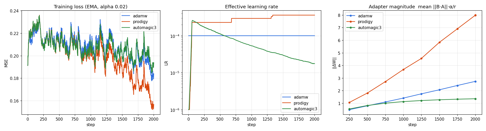
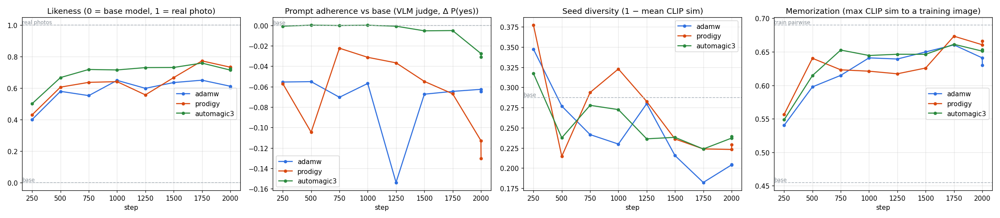

Portrait (in-distribution), seed 1:
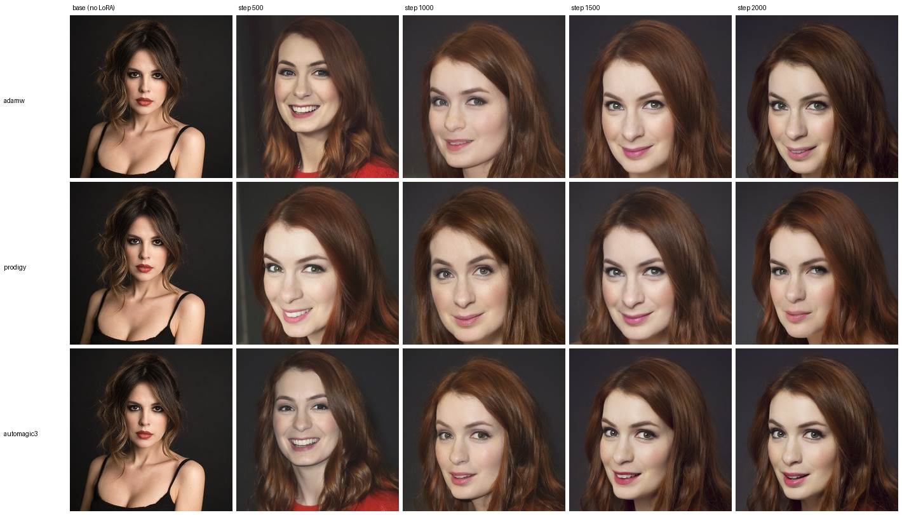

Café (out-of-distribution), seed 1:
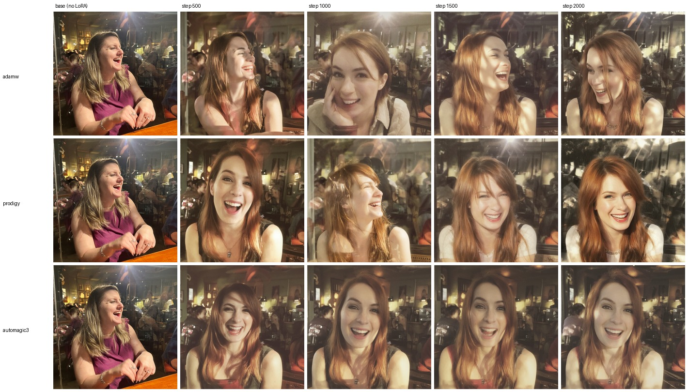

Knight, with `a woman` in the prompt, seed 1:
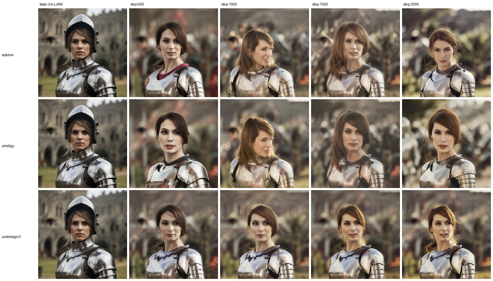

### Rhea Seehorn

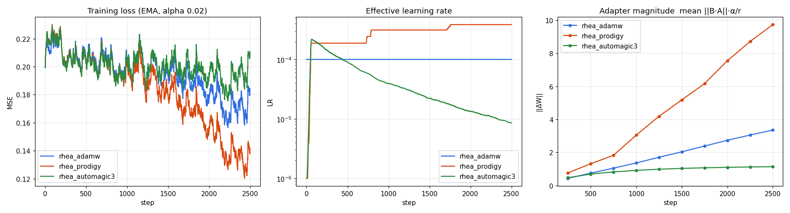
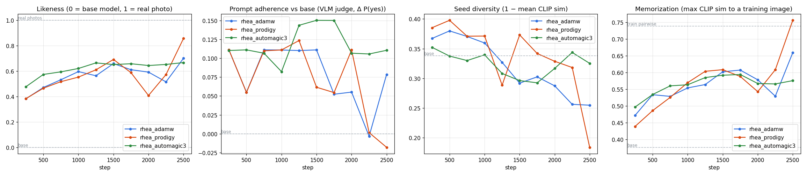

Portrait, seed 1:
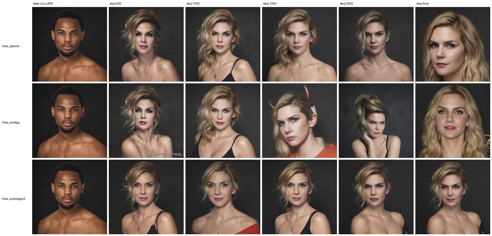

Café, seed 1 — the clearest single comparison. Automagic3 keeps the café, the crowd and her likeness steady from step 500 to the end; Prodigy's final checkpoint has dropped the café for a studio-style close-up:
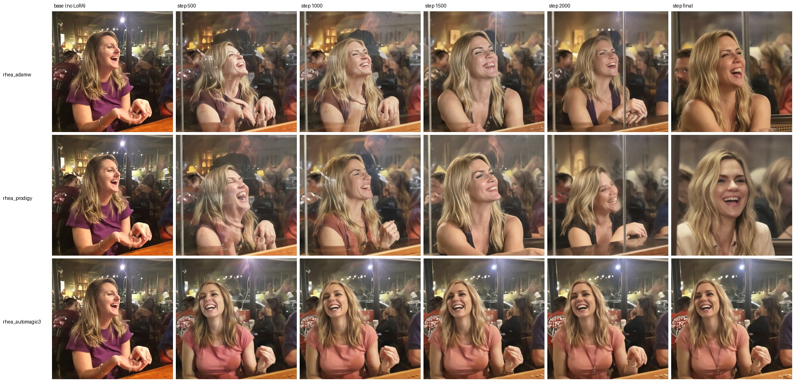

Knight, seed 1:
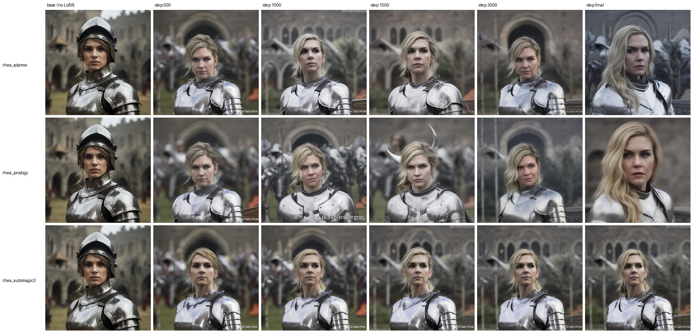

---

## What the benchmark shows

**1. Likeness is a tie.** On the in-distribution portrait, all three optimizers reach 0.72–0.83 — at or near real-photo similarity — and are visually indistinguishable. On the out-of-distribution prompts each optimizer wins somewhere and loses somewhere, within noise. None of them is better at identity.

**2. They differ in how hard they push, and that decides everything else.**

| | AdamW | Prodigy | Automagic3 |
| :-- | :-- | :-- | :-- |
| Learning-rate behaviour | constant 1e-4 | self-set ~2.3e-4, then **stepped up** during training, ending at 3.6e-4 (Felicia) / 3.9e-4 (Rhea) | spikes to ~2.2–2.6e-4 in the first ~100 steps, then **decays steadily** to 1.8e-5 (Felicia) / 8.5e-6 (Rhea) |
| ‖ΔW‖ at end | 2.7 / 3.4 | **8.0 / 9.7** | **1.4 / 1.1** |
| Adapter growth | linear | linear and steep | plateaus after ~1000 |

**3. Prodigy overcooks.** Its adapter grows fastest and never levels off. By the end of the Rhea run:
- memorization reached **0.76**, above the training photos' own pairwise similarity (0.74) — it had started reproducing training images;
- the café setting survived in only **33%** of images, and seed diversity collapsed to **0.18** (base model: 0.34);
- it was erratic mid-run: likeness 0.59 at step 1500, 0.36 at 2000, 0.72 at the end.

Its best likeness number coincides with its worst adherence and memorization — which is why likeness alone is a misleading target.

**4. Automagic3 is the most stable.** Its likeness plateaus by ~1000–1250 steps (Felicia ≈ 0.60, Rhea ≈ 0.56) and holds flat to the end. Adherence stays the best of the three (Felicia 1.00 at every checkpoint from step 500), diversity stays at base-model level on Rhea, and memorization stays flat. Checkpoints 1250 through 2500 are near-interchangeable, so **picking the step barely matters**.

**5. AdamW sits in between.** Good likeness from ~1000, decent adherence, but diversity erodes steadily (Rhea 0.38 → 0.25) and memorization creeps up late.

### Finding: the trigger does not carry gender

All captions in both datasets begin with `"a woman with …"`, so the trigger word always appeared *next to* the class word and never had to encode gender itself. Prompting `"feliciaday as a medieval knight"` — no class word — produced a **man** for all three optimizers — in the seed-1 grid below, at every checkpoint except Prodigy's step 2000 — because the knight prior is overwhelmingly male:

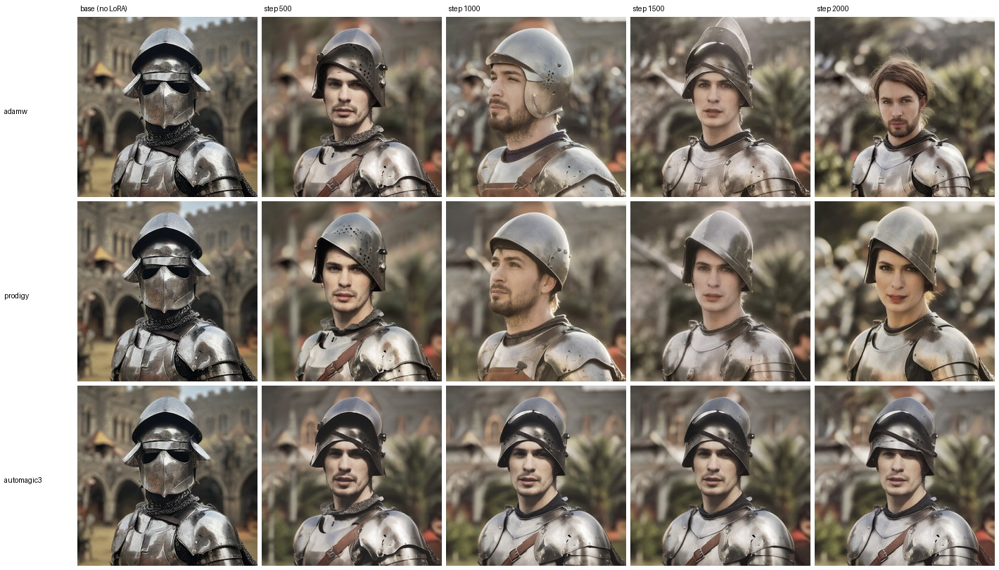

Adding `a woman` fixed it completely (100% women, every optimizer). The café prompt worked without it only because a café has no strong gender prior.

- **Using these LoRAs:** write `"<trigger>, a woman, …"`.
- **Future datasets:** caption as `"<trigger>, a woman with …"` so the trigger binds to the class word, or drop the class word so the trigger has to carry it.

---

## Training time (RTX 5090)

Measured from the training logs (512px, batch 1, rank 16):

| Subject | Optimizer | Steps | s/step | Wall time | Time to step 1500 |
| :-- | :-- | --: | --: | --: | --: |
| Felicia | AdamW | 2001 | 0.653 | 22.0 min | 16.6 min |
| Felicia | Prodigy | 2001 | 0.833 | 28.0 min | 20.9 min |
| Felicia | Automagic3 | 2001 | 1.067 | 35.9 min | 27.0 min |
| Rhea | AdamW | 2499 | 0.650 | 27.3 min | 16.5 min |
| Rhea | Prodigy | 2499 | 0.500 | 21.0 min | 12.7 min |
| Rhea | Automagic3 | 2499 | 0.620 | 26.0 min | 15.5 min |

- **Optimizer choice does not change speed.** The Felicia runs shared the GPU with a running ComfyUI instance (image generation during those runs was 6.7 s/image vs 3.9 s/image on a free GPU), which is why they are slower and vary more. Uncontended, all three run at **~0.50–0.65 s/step** — the 7B forward/backward dominates; optimizer overhead is negligible.
- Setup before the first step — caching VAE latents and Qwen3-VL text embeddings, then loading the transformer — takes **9–16 s** for ~20 images. Checkpoint saves are negligible.
- GPU memory during training ≈ **11 GB** (whole-GPU `nvidia-smi` reading with nothing else loaded).

**Recommended setting — Automagic3, 1500 steps: ≈ 13–16 minutes end to end** (12.5 min at the best measured 0.50 s/step, 15.5 min measured on the Rhea run). Checking the result by sampling each saved snapshot with a few seeds adds ~4 s per image.

**Cost of this benchmark:** Felicia — 86 min of training (3 runs) + 28 min generating 252 images + 10 min for the corrected knight rerun (84 images). Rhea — 74.5 min of training + 20 min to generate and score 279 images. **≈ 3.8 GPU-hours total**, all on one RTX 5090.

---

## Caveats

- **Small samples:** 3 seeds × 3 prompts per checkpoint detects large effects, not small ones. Likeness standard errors are ~0.02–0.04 per optimizer (late checkpoints pooled).
- **ArcFace coverage:** faces were detected in 16/23 Felicia and 19/21 Rhea training photos — enough for a stable reference centroid.
- **The VLM judge is decisive** (probabilities near 0 or 1), so adherence gets its granularity from averaging checks and seeds.
- **Square 512×512 only.** maltrainer currently trains at square 512×512, and more resolutions plus an aspect-ratio bucketing system are planned. Qwen-Image 2.1's native resolution is ~1328px. Likeness is already strong at 512; higher resolution is the next lever for fine detail and was not tested here. Both datasets were already square, so squashing non-square images was never a factor.
- **Two subjects, both women, both close-up portrait datasets.** The conclusions on optimizer *behaviour* (Prodigy's LR growth, Automagic3's decay) held on both, but they have not been checked on other kinds of subjects or on styles.

---

## Recommended config

```yaml
lora:
  rank: 16
  alpha: 16
  target_modules: ["to_q", "to_k", "to_v", "to_out.0", "gate_up", "img_mlp.out"]
  dtype: "float32"

train:
  batch_size: 1
  max_steps: 1500                 # stops exactly here; set 0 to train num_epochs instead
  num_epochs: 70                  # used when max_steps is 0; aim for 60-80 epochs
  save_every: 250
  optimizer: "automagic3"
  learning_rate: 1.0e-6           # launch point only - Automagic3 adapts it
  automagic_polarity_history: 8
  automagic_clip_threshold: 1.0
  automagic_beta2: 0.999
  weight_decay: 0.01
  timestep_distribution: "shift"
  max_grad_norm: 1.0

dataset:
  resolution: 512
  trigger: "yourtrigger"          # caption as "yourtrigger, a woman with ..." (see the caption finding)
```

## Reproducing

Configs: `config/train_qwen_image_2_1_feliciaday_bench_{adamw,prodigy,automagic3}.yaml` and
`config/train_qwen_image_2_1_rheaseehorn_bench_{adamw,prodigy,automagic3}.yaml`.
Prompt sets: `config/bench_prompts/rhea_prompts.json` (Rhea) and `config/bench_prompts/knight_woman_prompts.json` (the corrected Felicia knight prompt; Felicia's other prompts are the defaults in `qwen_2_1_bench_generate.py`).

```bash
# 0. sanity-check the stack (VAE latents, text conditioning, DiT) before any training
venv\Scripts\python.exe scripts\qwen_2_1_stack_probe.py --config config\train_qwen_image_2_1_rheaseehorn_bench_automagic3.yaml

# 1. train (one per optimizer)
venv\Scripts\python.exe train_qwen_image_2_1_lora.py --config config\train_qwen_image_2_1_rheaseehorn_bench_automagic3.yaml

# 2. sample every snapshot of every run (+ base model), 3 prompts x 3 seeds
venv\Scripts\python.exe scripts\qwen_2_1_bench_generate.py --outdir samples\bench_rhea --prompts-json config\bench_prompts\rhea_prompts.json ^
    --configs config\train_qwen_image_2_1_rheaseehorn_bench_adamw.yaml config\train_qwen_image_2_1_rheaseehorn_bench_prodigy.yaml config\train_qwen_image_2_1_rheaseehorn_bench_automagic3.yaml

# 3. score (ComfyUI venv: InsightFace, OpenCV, Qwen3-VL-4B judge)
C:\Development\ComfyUI\venv\Scripts\python.exe scripts\qwen_2_1_bench_score.py --bench samples\bench_rhea

# 4. charts + grids
C:\Development\ComfyUI\venv\Scripts\python.exe scripts\qwen_2_1_bench_report.py --bench samples\bench_rhea ^
    --runs rhea_adamw=output\bench_rhea_adamw rhea_prodigy=output\bench_rhea_prodigy rhea_automagic3=output\bench_rhea_automagic3
```

Other tools: `scripts/qwen_2_1_sample.py` (single image, optional LoRA) and
`scripts/qwen_2_1_sweep_checkpoints.py` (all snapshots of one run on one prompt, with a contact sheet).
